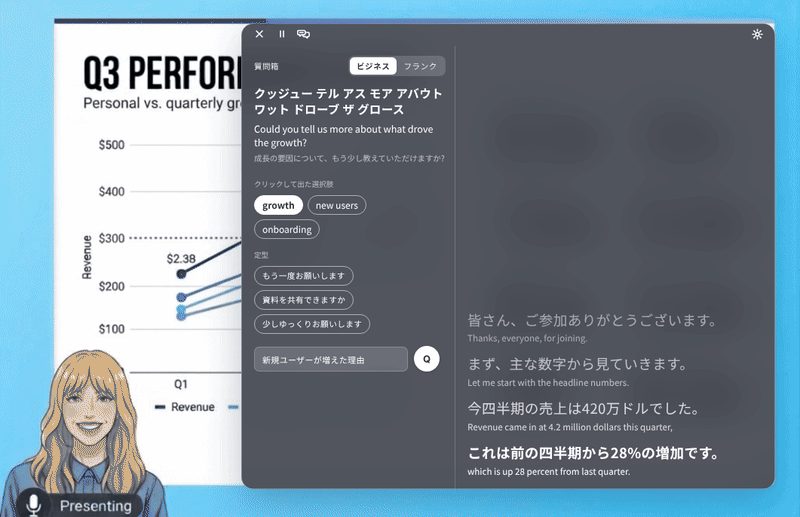
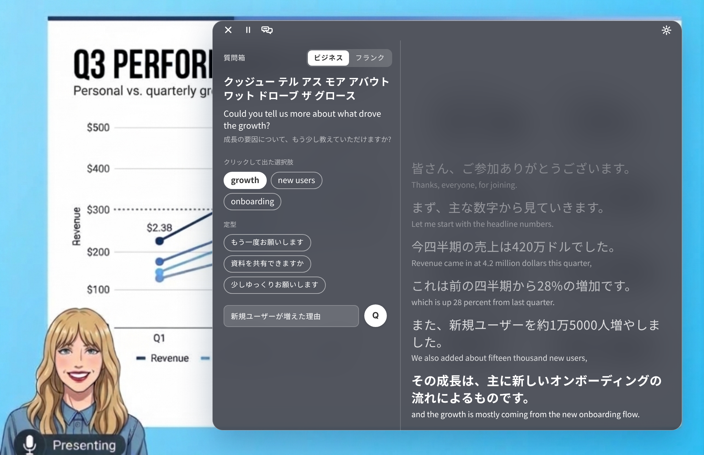

# JET

**Private, on-device English → Japanese live captions and reply drafting for macOS.**

JET listens to English audio — your microphone, or the system audio of a web meeting or a video — and shows Japanese captions about **1.6 seconds** after the words are spoken. A "question box" helps you prepare something to say in English. Speech recognition, translation and drafting all run on your Mac through Apple's on-device frameworks. The app makes no network calls, and it keeps nothing after you close it: no audio, no transcripts.

> Unofficial personal project. It is not affiliated with or endorsed by Apple or any other company mentioned here.

日本語版は [README.ja.md](README.ja.md) をご覧ください。


*Illustration composed for this README (not a screen capture). The slide behind the window is an original AI-generated image; the captions and questions are invented sample text.*



*Animated illustration (not a screen recording): new lines enter from the bottom and older ones fade as they move up; the settings panel then lowers the background density so a shared slide shows through.*

## Why

Cloud translation tools send your meeting audio to a server. JET is built around the opposite constraint: everything stays on the machine, and nothing is left behind. It is meant for following English-heavy web meetings or English learning material in real time, and for getting a little help with what to say next.

## Features

- **Flowing captions.** Japanese text in large type, the original English in small type below it. New lines stack at the bottom, older lines fade, and nothing is rewritten or replaced while you read. Scroll up to read back; "↓ latest" brings you back.
- **Question box.** Click words in the captions, pick one of 20 included templates (business or casual tone), and Apple Foundation Models drafts an English question. Each result shows katakana reading, English and Japanese; click to copy the English.
- **Hidden from screen sharing.** The window is excluded from screen capture (`sharingType = .none`), checked against a web-conference screen share.
- **Adjustable look.** Background density, light/dark appearance, font and text size, from a settings panel inside the window.
- **Menu bar app.** Start, pause and quit from the window bar or the menu bar. Mic and system audio are both supported.



*The same illustration with a denser background: the slide no longer shows through, and the captions stand out. A lighter setting (top) lets you keep an eye on a shared slide behind the window.*

## Privacy by design

- The app source contains no networking code (no `URLSession` or similar). Recognition and translation use on-device Apple frameworks.
- The built `.app` has no audio-recording feature and writes no events or recognition logs to disk. Captions live in memory and disappear when you quit.
- If there is something on screen that would be lost (captions, text in the question box, picked words, a draft being generated), quitting asks for confirmation first. There is no "save and quit" by design.
- The diagnostic log (`app.log`) never contains transcript text — only start, stop and error kinds.
- Limits: macOS's own logs and swap are outside the app's control, and the clipboard is yours (JET only writes to it when you click to copy).
- Terminal mode (`./menubar.sh`, `jetcli`) is a development mode: it writes events and recognition logs to `logs/` and can record audio with `--save-audio`.
- Your audio and text are never sent anywhere. The only thing that may be downloaded is the English speech-recognition model: if it is not installed yet, macOS downloads it once (JET itself has no networking code).

## Requirements

- A Mac that supports **Apple Intelligence**, turned on in System Settings (the draft translation and the question box use Apple Foundation Models). Apple lists "Mac with M1 or later" as supported; Intel Macs are not listed, and JET has not been tried on one. Your device language and Siri language must be a language Apple Intelligence supports, and Apple says it needs up to 8–14 GB of free storage. macOS downloads its models; if they are not ready yet, JET reports that the model is unavailable and you wait for the download to finish.
- Tested only on one machine: a Mac mini (24 GB) running **macOS 27.2**, **Xcode 27.1**, **Swift 6.4**. `Info.plist` sets a deployment target of macOS 26.0, but nothing below 27.2 has been tested.
- `swiftc` with the macOS SDK (Xcode 27.1 / Swift 6.4 on the test machine; older Xcode or Command Line Tools versions have not been tried). The frameworks used (Foundation Models, SpeechAnalyzer) require the macOS 26 SDK or later. `sips` and `iconutil` (included with macOS) are used to make the icon.

## Build and run

There are no prebuilt binaries. Build it yourself:

```sh
git clone https://github.com/BullManJPN/JET.git JET && cd JET
./build_app.sh
open JET.app
```

**Signing.** `build_app.sh` signs with a self-signed code-signing certificate named `JET Local Signing`, if you have one. This keeps macOS from asking for permissions again after every rebuild. To make one: Keychain Access → Certificate Assistant → Create a Certificate… → name `JET Local Signing`, identity type *Self-Signed Root*, certificate type *Code Signing*. Without it, the build falls back to ad hoc signing and works, but macOS may ask for permissions again after each rebuild. (Use `JET_SIGN_ID="other name" ./build_app.sh` for a different certificate name.)

**Terminal mode** (development): `./menubar.sh` builds `jetcli`, runs the self-tests, and starts the menu bar app. `./jetcli --selftest` runs the tests alone.

## Permissions

| Permission | Used for |
|---|---|
| Microphone | Listening through the mic |
| Speech Recognition | On-device English recognition |
| Screen & System Audio Recording | Capturing the audio of a meeting or video (ScreenCaptureKit) |

If you start JET from Terminal, macOS attaches these permissions to Terminal, not to JET. Restart Terminal after granting Screen & System Audio Recording.

## Using JET

1. Open the app and press **start** in the window bar (or use the menu bar item); pick *Microphone* or *System audio* from the menu.
2. **Pause** stops listening but keeps the lines on screen. **×** quits (while listening, press it twice).
3. Move the window by its top bar or with ⌘-drag; resize from edges and corners; ⌘+ / ⌘− change text size.
4. Hover the speech-bubble icon in the bar to peek at the question box; click it to pin it as a left column.
5. In the captions, click a word to pick it (Shift-click to join words). Choose a template and tone, optionally type what you want to say, and press **Q**.
6. The gear at the right of the bar opens the settings panel (look, fonts, and the question-box templates).

### Pronunciation dictionary (katakana readings)

Katakana readings come from the bundled CMU Pronouncing Dictionary (`asr/cmudict.dict`, see [THIRD_PARTY_NOTICES.md](THIRD_PARTY_NOTICES.md)) plus rules. If the file is missing, readings are switched off and the app says so. To restore it:

```sh
curl -L -o asr/cmudict.dict https://raw.githubusercontent.com/cmusphinx/cmudict/master/cmudict.dict
```

## Configuration

- `jet.json` holds the defaults. For the `.app`, your changes go in `~/Library/Application Support/JET/jet.json` and only the items you change are stored; the bundled defaults are layered underneath.
- Question-box templates: `prompts/qbox_templates.tsv` (edit from the settings panel; your edited copy lives in Application Support).
- Recognition term fixes: `asr/terms.txt` and `asr/term_aliases.tsv`. Your own lines are merged in front of the bundled ones.

## How it works

```
audio ─▶ SpeechAnalyzer (volatile text) ─▶ LocalAgreement (a word is confirmed
         after 2 matching updates) ─▶ clause detection ─▶ Apple Foundation Models
         (draft translation, no context, greedy) ─▶ flowing captions
```

Decisions that came out of measurement (details and numbers in [research/FINDINGS.md](research/FINDINGS.md)):

- **No few-shot examples.** Apple's on-device model treats examples as text to copy. Eight examples raised leaked example text to 212 cases and bad translations to 39%; no examples gave 93.2% readable translations (among clauses whose recognized English was clean) and no leaks.
- **Word-level confirmation.** Waiting for the recognizer's own final results took a median 3.4 s; confirming words that match in two consecutive updates took 1.3 s.
- **Wait up to 3 s for unknown words.** Garbled intermediate words dropped from 16.5% to 8.2% of clauses at no change in median delay.
- **Drafts only.** Captions are never rewritten. A cloud "final translation" stage was built, measured and removed to keep everything local.

## Measured behavior

On the test machine: English appears about 1.3–1.4 s after speech, and the Japanese draft appears 0.26–0.32 s after a clause closes (about 1.6 s in total). Numbers are from one Mac mini and a small set of public videos and are indicative, not a benchmark.

## Limitations

- Draft translation quality is the on-device model's: recognition errors are translated as heard, and a few translations flip the meaning (negation, comparisons, numbers). Treat captions as an aid to follow along, not as a transcript or a translation of record.
- The model can occasionally stop on its safety guardrails or mix in Chinese characters; JET then shows the English instead.
- English → Japanese only. Single machine tested. The question box is for preparing what to say, not for instant answers.

## Responsible use

Recording or transcribing a call can be restricted by law, by your organization, or by the other participants. Check the rules that apply before using JET in a meeting, class or any other situation with other people, and follow them — including any rules about assistive tools in exams or other assessments. The screen-share-hidden window is meant to keep your own screen tidy, not to hide the tool from people who are entitled to know.

## Repository layout

| Path | Contents |
|---|---|
| `jet/` | Swift source of the app |
| `app/` | `Info.plist`, app icon |
| `prompts/`, `asr/` | Prompts and question templates; term lists, pronunciation dictionary and word list |
| `docs/` | Design notes, decision log, and the ASR / translation research reports |
| `research/` | Findings summary, measurement scripts and prompt variants (reference only; the audio and transcripts used are not published) |

`research/` includes a few scripts that call the Anthropic API for scoring translations; they need your own API key and are unrelated to the app.

## License and credits

MIT — see [LICENSE](LICENSE). Bundled data and their notices: [THIRD_PARTY_NOTICES.md](THIRD_PARTY_NOTICES.md). Apple, macOS, Apple Intelligence and Foundation Models are trademarks of Apple Inc.
